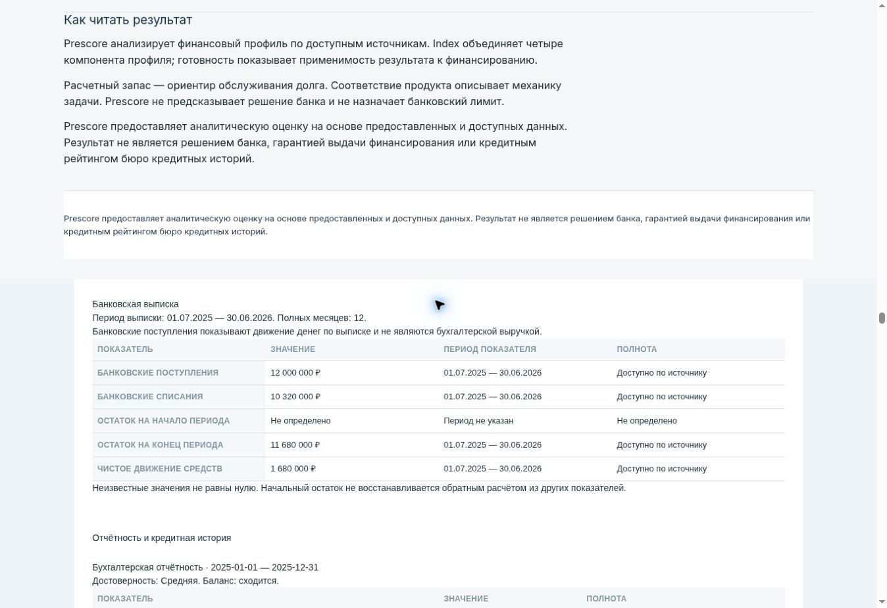
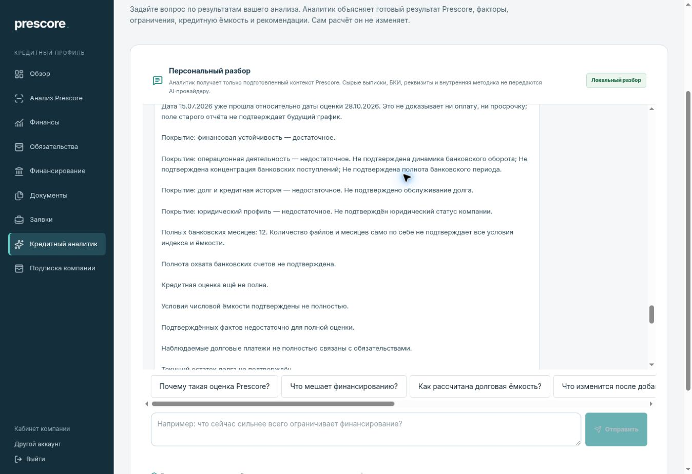

# Print and local AI — live acceptance of db33a762

Continuation of #11 after comment 6469622804. One bounded acceptance pass on 2026-10-28; no implementation, deployment or repeat build. This is manual browser Work acceptance, not an automated Playwright suite and not acceptance of all 19 blocks.

## Version and runtime

- GitHub staging still `db33a7624ea061879fe8e2efb32e0b58c75e4993`; tested recovery code `1d693c2ec6b48eb2273281d74e7fb5a8a6b24bd5`; GitHub tree `ba7c020f2a20b45e9462a0903b35ca4639eba83d`. No newer completed acceptance was present at the start. Recovery was rechecked before this documentation update and still pointed to the tested code.
- Amvera `prescore-staging`: imported revision `2cbc84ddc51c9ebf199ad9360d8dce0e3c3e10b0`, successful build check and **used/active check** in Version Control; app running, 1/1 replicas. Prior `0fc268e4d611bb4bf5cc9bf4c29c762a095936c4` is no longer used. UI row date **28.10.2026 16:19**, commit date **28.10.2026 15:00**; UI timezone not independently confirmed.
- The bounded log filter returned no rows in its selected three-hour window. It is not a build failure and is not evidence of the individual gate lines. SUCCESS/activation are supported by Version Control; no numeric build exit code is invented from its icons. No further status polling or build/restart/cancel was performed.
- Fresh ordinary GET `/api/health`: **HTTP 200**, 10,256 ms, `2026-10-28T18:07:17.773555+00:00`. Release `PRESCORE-V1-RC3-20261019`, schema `0009_analysis_archive.sql`, build timestamp `2026-10-28T13:10:53.688Z`, build ID `JW6lHhRCTtf4d6hisq3b8`.
- Fresh `/api/ready`: **HTTP 200**, 6,154 ms, `2026-10-28T18:07:23.928092+00:00`, `ready=true`, `code=READY`; configuration VALID, database REACHABLE, schema COMPATIBLE, storage READ_WRITE, outbox ACCESSIBLE. These are observed request durations, not comparative performance claims.
- Packaged fingerprint **`80a9e0f06b05f2c4638f695c9f4a17aef41874663372e8de62cae63cfa5bc797`**, scope **PRESCORE-SOURCE-INPUTS-1**, **707 files**; lock SHA-256 **`8fc1937ff193da2f1cd7504442f2dd64e44559306a0f77d2775af83e17f9deb1`**. All match the expected candidate.
- Provenance status `PACKAGED_INPUT_FINGERPRINT`, checkout `UNAVAILABLE`; sourceSha/sourceTree `UNKNOWN`, published/running digest null. **Full imported-tree and running-image identity remain PARTIAL / TRACEABILITY_BLOCKED.** Matching the defined source-input scope does not prove the complete Git tree or either image digest. No expected SHA was placed in runtime configuration and no build was requested for missing metadata.

## Results

All live results below apply to the active Amvera revision above and its matching source-input scope.

| Item | Result | Evidence |
| --- | --- | --- |
| BUILD_AND_ACTIVATION | PASS | Success and used checks on new revision; previous revision not used; running 1/1. |
| HEALTH_READY_AND_SOURCE_INPUTS | PASS | Fresh 200/200 READY, exact fingerprint/scope/count/lock match. |
| PRINT_BANKING_PARITY | PASS | Ordinary “Печать / PDF” link opened the protected report for the working analysis; banking labels, RUB values and individual periods match the fresh workspace-model. Source table retains bank period. Accounting periods and historical/current debt remain separate. |
| PRINT_CONTROL | PASS — screen control | Visible enabled “Печать / сохранить PDF” in “Управление печатью”; no automatic dialog on opening. Dark text now readable on white disclaimer background. This does not certify an exported PDF. |
| PDF_EXPORT_AND_VISUAL | BLOCKED | One ordinary print-button click: no download within 12,000 ms, no exposed save/print dialog; cloud browser has no supported general product-page PDF export and native control is unavailable. No substituted PDF. File, page count and SHA-256 unavailable; zero PDF pages visually inspected. |
| AI_PERIOD_EXPLANATION | PASS — requested meaning | New 1.2 answer gives annual 12 months versus actual six-month CUMULATIVE_YTD, exact revenue/profit/periods, and expressly rejects automatic annualization or treating half-year totals as equivalent annual deterioration. |
| AI_DEBT_DATES_AND_BASIS | PASS | New answer separates current UNKNOWN from dated historical 1.5m, dates overdue zero to the source, identifies 15.07.2026 as past relative to explicit 28.10.2026 assessment, and says this proves neither payment nor default. Observed service is explicitly distinguished from a confirmed future schedule. |
| AI_INDEX_AND_CAPACITY_LIMITATIONS | PASS — current-model reasons | Composite question includes both index and capacity, actual five missing fact codes in Russian, account coverage, freshness, unknown current principal, incomplete schedule and unmatched payments; 12 months/files do not establish sufficiency. No FNS-only or approval promise. |
| FINANCIAL_SOURCES_UNCHANGED | PASS | Exact before/after equality of nine financial/source projection groups. All four sources remain READY; no analysis/source parameter change. |

## Print controls and financial parity

Working synthetic analysis: `36527dc1-d7db-4fef-bd47-719a451b4d58`, ООО PRESCORE QA UPLOAD 20261028 SYNTHETIC, synthetic INN 9900002906. QA A was not modified or messaged.

The real report route was opened through the existing client link: `/dashboard/report-v2?analysisId=36527dc1-d7db-4fef-bd47-719a451b4d58&print=1`.

| Report field | Live API and print result |
| --- | --- |
| Bank period / history | 01.07.2025–30.06.2026 / 12 full months; also present in bank source table |
| Bank inflow | 12,000,000 RUB, explicitly labelled bank inflow, with the bank period |
| Bank outflow | 10,320,000 RUB, with the bank period |
| Closing balance | 11,680,000 RUB, with the bank period |
| Net movement | 1,680,000 RUB, with the bank period |
| Opening balance | Not determined; not reverse-calculated or replaced with zero |
| Annual accounting | 01.01–31.12.2025: revenue 12,000,000 and net profit 2,160,000 RUB |
| Interim accounting | 01.01–30.06.2026: revenue 6,000,000 and net profit 1,080,000 RUB, separate heading |
| BKI | Historical principal 1,500,000 RUB on 30.06.2026; current principal not determined on 28.10.2026; source next payment 100,000 RUB dated 15.07.2026 preserved |
| Result | Index/readiness/capacity still insufficient, not fabricated from four documents |

Bank rows and the fixed disclaimer were visually inspected on the HTML product page. This is not an all-page PDF inspection.

[Screen print control](evidence/2026-10-28-db33-print-control.jpg)

## New local answers and authorized writes

Before any submission, the normal authorized AI GET returned `available=true`, `mode=rules`, `providerConnected=false`, `promptVersion=PRESCORE-AI-ANALYST-CANONICAL-1.2`, **zero messages**. Reviewed existing route/provider selection: GET reads the same key/model configuration required to select an external provider on POST; without the pair the deterministic fallback is selected. No provider request, mode/settings change or paid smoke test was made.

Exactly these three questions were submitted once each through the normal UI:

1. «Сопоставь годовую и промежуточную выручку и прибыль. Почему эти периоды нельзя сравнивать как одинаковые?»
2. «Какой остаток долга подтверждён сейчас? Что означают 1,5 млн рублей на 30.06.2026 и платёж 100 тысяч на 15.07.2026? Подтверждают ли они сегодняшний долг или будущий платёж?»
3. «Почему индекс и долговая ёмкость не рассчитаны, хотя загружены четыре документа и есть 12 месяцев? Перечисли реальные недостающие подтверждения.»

New answer times (UTC): **18:15:26.230**, **18:15:44.998**, **18:16:04.384**, 2026-10-28. A fresh history GET after completion confirms **3 user + 3 assistant messages**, still rules/false/1.2, in one namespace `canonical-1193d57234ac53d91f115f58cb61510465d881e23e824e9b61cb8e15079ea7e2`. No POST was repeated. Old 1.1 messages were neither used as evidence for this version nor deleted/rewritten.

The third answer's reasons match the actual canonical coverage: FINANCIAL_STRENGTH ADEQUATE; BANK_OPERATING_TREND, BANK_TOP1, BANK_COVERAGE_ADEQUATE, BANK_DEBT_SERVICE_RATIO and LEGAL_LIFECYCLE missing in the other three components. It also reflects ACCOUNT_COVERAGE_NOT_PROVEN, SOURCE_STALE, PORTFOLIO_OUTSTANDING_UNKNOWN, PORTFOLIO_SCHEDULE_INCOMPLETE and DEBT_PAYMENT_UNMATCHED capacity constraints. Observed service 100,000 RUB is not represented as a proven future contractual payment. The existing published next action remains obtaining confirmed outstanding balances.

**Residual presentation limitation:** the appended generic factor prose still repeats phrases within paragraphs. The specific requested explanations are now present and correct; no claim is made that all stylistic repetition has been removed. The duplicate date placeholder “не указан — не указан” is absent from the new responses.

Application writes were limited to those **six new test messages**, the ordinary conversation metadata update and three usage-record writes on the successful handler path. Message counts were directly read back; metadata row count is inferred from that handler path, not independently queried with SQL. Numeric HTTP status for authorized workspace/AI/POST responses was not exposed by the browser and is not invented.

## Preservation, prior local gates and remaining scope

Fresh workspace-model before/after: exact equality of analysis/company/period, complete source summary, all bank facts/months, FULL banking source IDs/periods, financial history, BKI portfolio, full canonical index, readiness and debt capacity. Both serialized projections SHA-256 **`44b5c8e677ec08611cf15a9350835c1effc15b2a86b95047b4f577180936aeb8`**. Technical conversation/operation counters were not included. Four sources remain READY. [Bounded evidence and answer hashes/excerpts](evidence/2026-10-28-db33-acceptance-safe.json); no full workspace payload, source document, token or cookie is included.

Preserve final local evidence from comment 6469622804 for code `1d693c2ec6b48eb2273281d74e7fb5a8a6b24bd5`: typecheck zero diagnostics; build exit 0; corrected targeted 53/53; full regression **6795/6795, 0 skipped**; Credit Lab **24/24**; lint, standalone runtime assets and existing PDF text-runtime gate PASS. The initial source-contract failure remains documented in the matrix. These gates were not rerun in this live pass; the PDF runtime extraction gate is not an exported live PDF.

Remaining independent acceptance: actual product PDF file and visual pagination; permitted ASSIGNED_BROKER session/assignment; live trusted legal intake/full numeric scenario; full imported tree and running image digest. Next concrete unchecked scenario is ordinary product PDF export and visual review of every page in a supported session. No new build is needed just for metadata.

No code, production, DNS, configuration, roles, tariff, payment, financial source, upload, new analysis, manual SQL/migration, FNS or external AI request was changed/performed. This evidence is documentation-only in recovery and must not be transferred to staging.
